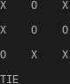

# ttt

small tic-tac-toe implementation written in c

## requirements

* a unix-like system (linux, freebsd, etc.)
* a compiler that supports C89 or above
* the make utility

## how to compile

to compile it, run `make`.  
to also install it on your system, run `sudo make install`. (or `doas make install` if you're using doas)

## license

this project uses the x11 license

## repositories

this project is in [github](https://github.com/yanzoro/ttt) and [codeberg](https://codeberg.org/yanzoro/ttt)

## special thanks!

thank you [Com4t](https://github.com/Com4tGPU) for contributing :D

